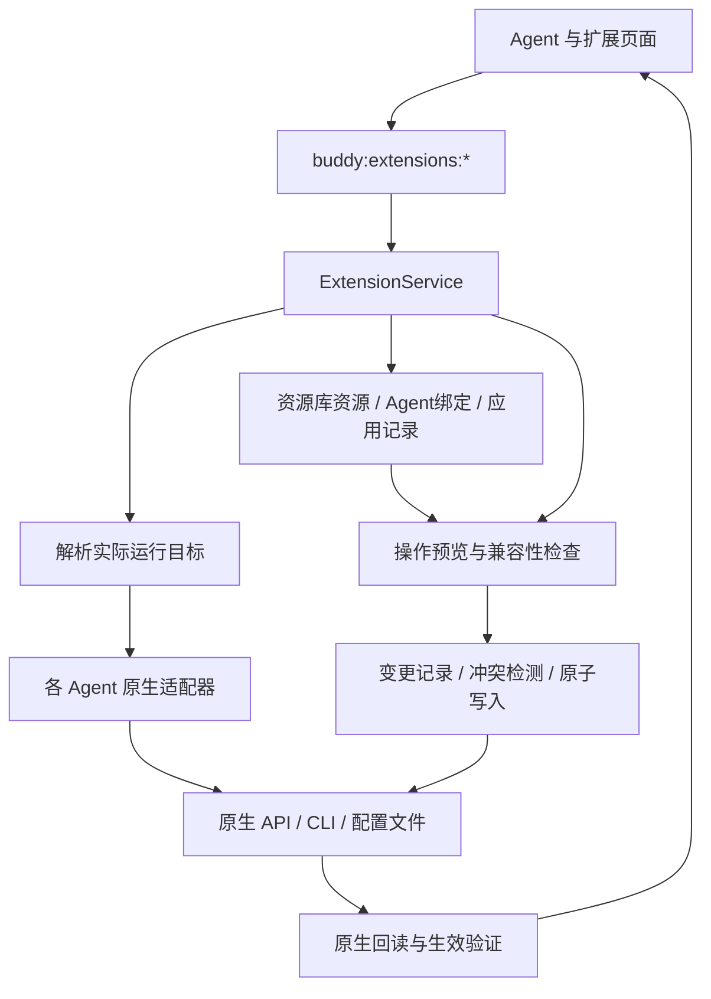

# 参照 Magpie 实现 Buddy Agent 与扩展管理

日期：2026-10-28；2026-10-29 修订。状态：已交付首轮资源库及本次界面/分发修复，尚未达到 Magpie 全功能等价。远程可替换目录服务、内置编辑器、插件独立管理入口为明确后续增强；Cursor / agy / Kimi / dsh 写入仍关闭（安全底线）。能力记录见 `docs/extensions/capability-baseline.md`。验收见第 7 节。

## 2026-10-29 已落实的讨论结论

- MCP 登录共享网关不在对齐范围：各 Agent 使用原生登录、凭据存储与续期；同一原生环境已有的认证共享继续遵从其自身行为。配置分发成功不证明登录或模型加载成功。
- 技能/MCP 页面删除 `All / Claude · 已读到 / …` 扫描筛选条，Agent 页提供发现诊断。库内技能行的 All 和 Agent 按钮继续控制分配。
- 库列表标题栏「按 Agent」打开分配管理面板：按资源类型显示每个 Agent 的数量，全部开启/关闭仅作用于该 Agent。它与搜索、多选独立；技能下方的按 Agent 链接/副本设置另行命名。
- 原生共享目录技能显示锁定的可用状态和来源路径；分配管理跳过这部分，不能报告已关闭。后台直接撤回请求返回 `shared_visible`。
- MCP 从来源格式转换为目标原生格式后再安全写入与撤回，覆盖 Claude JSON、Codex TOML、OpenCode 命令数组与 environment；保留嵌套 env。缺失配置可在已初始化的目标创建，未初始化 home 继续阻断。认证文件不读取、不复制。
- 验证：六个方向的 stdio MCP 分发/撤回回归；共享目录保留；React 单 Agent 面板交互与共享锁；Playwright 浏览器中 0/2 → 2/2 → 0/2。浏览器通过模拟 IPC 验证界面，后台通过隔离目录测试，未代表真实 Agent 会话/OAuth 加载验证。

完整对齐仍有未交付项：在线技能市场、仓库探测后选择安装及更多 Git 地址、独立项目资源管理、完整 MCP 编辑/远程检测/工具开关、外部指令持续同步、子代理关联资源、更多 Agent 的写适配与 RTK。后文历史 pass 仅对应当时列出的局部测试，不能作为这些功能已完成的依据。

## 1. 建议与目标

在 Buddy 主侧栏新增独立「资源库」入口，直接移植 Magpie 资源库的业务流程与交互组织，用 Buddy 的 TypeScript/Electron 实现承接。用户提供的资源库技能页截图是产品验收依据：保留「Agent 中已有 → 导入 → 资源库统一管理 → 分配给 Agent 使用」以及「资源库保存一份技能，再链接到所选 Agent」的逻辑。

核心目标：让资源库管理导入或添加的资源内容、更新和 Agent 分配；Agent 原生配置负责加载资源库分发的内容。原生发现与配置适配是后台支撑，产品主流程围绕资源库展开。

核心流程是：**从某个 Agent 发现扩展 → 加入资源库并纳入管理 → 在资源库按 Agent 开关是否使用 → 原生回读验证**。资源库是可持久化的资源与分配管理中心，不能只做原生清单和一次性批量安装。

采用三条明确的操作路径：

1. **Agent 中已有**：发现尚未入库的资源，显示名称、描述、拥有它的 Agent、共享位置与链接来源，提供「导入」「选择」「全部导入」。
2. **导入资源库**：依 Magpie 的导入规则归集资源、保存来源并建立 Agent 分配，原本使用它的 Agent 导入后继续使用。独立技能目录迁入资源库并在原位置建立链接；已有共享源或外部链接保留在原处，由资源库引用。
3. **资源库中管理**：每项资源在行内展示 Agent 按钮及 All；切换按钮修改目标分配，由资源库创建或撤回对应链接、受管理副本或原生配置。资源库内容保留，可重新分配；编辑、更新、备份和删除也在这里完成。

本方案以本次截图和用户明确要求的 Magpie 资源库逻辑为准。加入资源库即授权按导入规则归集该资源并管理其分配；未加入的资源保持原样。默认使用共享链接，副本模式沿用 Magpie 的标记、编辑回收、同步及备份机制。Buddy 的差异集中在现有 UI 风格、TypeScript 实现、CLI/ACP/WeCode 目标适配，不另行设计一套仅逐目标手动应用的资源管理规则。

## 2. 本次核查基线

### Buddy 当前状态

- 当前分支为 `main`，基准提交为 `08db6e874a6f6f9b9af7604a93aef9130fa2d5cf`，核查开始时工作区干净。
- `SettingsContent.tsx:33` 目前只有 general、appearance、keyboard、prompts；General 中已有 Launcher 的 CLI/ACP 配置与测试。
- `src/shared/defaults.ts:3` 定义了 10 个 Actor：Claude、Codex、Cursor、Antigravity、OpenCode、Kimi、dsh、WeCode Claude、WeCode Codex、WeCode OpenCode。
- 当前 checkout 没有 `src/main/buddy/extensions/` 或独立扩展管理页面，也没有此前讨论的两份 2026-10-27 计划。本方案按新增模块设计，不把历史实现当作当前基础。
- `Launcher` 支持 command、args、env、protocol；任务可覆盖全局 Launcher，不能只用 Actor 名称推断配置目录。
- Codex ACP 的 `config.toml` 和全局 AGENTS 文件仅首次复制到私有目录，skills/rules 以软链共享。具体见 `src/main/buddy/acp/codex-home.ts:160` 与 `docs/acp-codex-storage.md`。
- ACP client 支持会话级 `mcpServers`，Runner 当前未传入，默认是空数组。这只说明没有 Buddy 显式注入，不能据此判定 Agent 不加载自身 MCP。

### Magpie 参考范围

固定参考提交：[c3b0484a96ef4bc3cdb43cc53f68f56c996933e7](https://github.com/yetone/magpie/tree/c3b0484a96ef4bc3cdb43cc53f68f56c996933e7)。页面结构依据用户截图，数据流依据此提交源码；本次没有运行 Magpie。

| 已核实的参考功能 | Buddy 采用方式 |
| --- | --- |
| 资源库中区分自己管理的资源与 Agent 已有资源 | 明确展示「资源库」与「Agent 中已有」；后者提供加入资源库，前者提供各 Agent 使用开关 |
| 每行有 Agent 选择、All、多选和批量操作 | 直接采用行内 Agent 按钮与 All，支持按 Agent 筛选；不以独立的宽矩阵表取代该主界面 |
| MCP 手动添加、粘贴配置、发现、项目配置、健康检测和工具列表 | 作为 MCP 完整工作流，按适配器能力开放 |
| 技能从仓库、本地目录、发现页安装，按来源分组、检查更新 | 作为技能完整工作流，记录仓库 ref、commit 与本地修改状态 |
| 指令、子代理、Hooks 也在资源库体系内 | 放入后续阶段，保留各 Agent 的格式与语义差异 |
| Applied 记录自身写入内容，变更备份并返回分目标错误 | 借鉴为操作记录、条件撤销与部分失败反馈 |

参考实现：[资源库设计](https://github.com/yetone/magpie/blob/c3b0484a96ef4bc3cdb43cc53f68f56c996933e7/docs/subsystems/library.md)、[Library 与 Applied](https://github.com/yetone/magpie/blob/c3b0484a96ef4bc3cdb43cc53f68f56c996933e7/internal/library/library.go)、[页面逻辑](https://github.com/yetone/magpie/blob/c3b0484a96ef4bc3cdb43cc53f68f56c996933e7/internal/gui/assets/plugins/library/client.js)。

直接沿用的机制及 Buddy 接入边界：

- 沿用中心资源库和 Agent 分配方式。Agent 按钮表示是否向该 Agent 提供资源；关闭撤回受管理分发，保留库内内容。原生禁用状态可作为附加状态展示，不将其另做一套取代资源库分配的主流程。
- 沿用技能单份内容、链接优先和可选副本模式。对 Magpie 管理方式覆盖的普通副本，先回收最新编辑、备份被替换版本，再同步所选 Agent；特定 Agent 的例外按对应适配器保留。
- Magpie 的部分 MCP 登录共享依赖其本地网关。Buddy 优先调用目标 Agent 的原生认证，不为扩展管理新增 MCP 代理网关。
- Magpie 的技能详情主要是预览与路径定位。首轮完成该体验；内置编辑器是后续增强，不阻塞导入与资源库统一管理。
- Magpie 的 Provider / 登录 / 网关中间件插件，与 Claude/Codex 等 Agent 的原生插件不是同一体系。本方案的「插件」指 Agent 原生插件。

对应源码：[技能导入](https://github.com/yetone/magpie/blob/c3b0484a96ef4bc3cdb43cc53f68f56c996933e7/internal/library/skills.go#L2018)、[MCP 分发与撤回](https://github.com/yetone/magpie/blob/c3b0484a96ef4bc3cdb43cc53f68f56c996933e7/internal/library/sync.go#L210)、[技能副本编辑同步](https://github.com/yetone/magpie/blob/c3b0484a96ef4bc3cdb43cc53f68f56c996933e7/internal/library/skill_edits.go#L3)、[MCP 登录与网关](https://github.com/yetone/magpie/blob/c3b0484a96ef4bc3cdb43cc53f68f56c996933e7/internal/library/mcp_signin.go#L17)、[技能内容预览](https://github.com/yetone/magpie/blob/c3b0484a96ef4bc3cdb43cc53f68f56c996933e7/internal/gui/assets/plugins/library/client.js#L4802)。

## 3. 页面方案

主侧栏提供独立「资源库」，子页面依图组织为「指令 / MCP 服务器 / 技能 / Hooks / 子代理」。Agent 页承接现有 Launcher 配置并链接到相关资源。插件管理作为独立入口保留后续范围，不把截图中的插件入口误并入资源库；RTK 另行评估，不作为技能/MCP 导入流程的依赖。

### Agent 页

每个 Actor 独立展示名称、运行方式、实际程序、版本、安装/连接状态和扩展能力。WeCode 三个变体分别展示，不因为底层同族就合成一项。

点击后显示当前工作区/任务所用 Launcher、底层 Agent、实际配置位置和可用操作。自定义命令无法识别时显示「未识别」，允许检查启动配置，不对猜测出的目录开放写入。

### 资源库技能页：按截图组织

- 顶栏：资源库 / 技能路径，以及「发现」「资源库文件夹」「备份」「刷新」。
- 安装入口：输入 owner/repo、GitHub/GitLab 链接、其他 Git 仓库地址或本地文件夹，点击「查找技能」。
- **资源库中**：有已导入/添加资源时出现在前面；列表或来源分组中展示名称、描述、更新状态、行内 Agent 按钮与 All，支持按 Agent 查看、选择、全部开关、检查更新和删除。
- **Agent 中已有**：只列出尚未入库的实例；显示来源 Agent、共享于/链接自路径，逐行「导入」，分区上方「选择」「全部导入」。导入成功后该实例转到「资源库中」，不重复占据未导入列表。
- **发现**：搜索与推荐卡片，点击「添加」进入资源库并选择使用它的 Agent。网络失败不妨碍本地导入与管理。
- 详情保留内容预览、路径、来源、分发关系与操作记录；作用域和运行环境放在上下文选择/详情中，不挤占截图所示的主要流程。
- MCP 页面沿用相同的已入库/Agent 已有结构，并提供添加配置、健康检测等类型专属操作。

以下仅说明行内分配关系，不要求把页面实现为宽表，也不代表当前机器兼容性：

| 资源 | 来源 | Claude | Codex ACP | OpenCode | WeCode Codex |
| --- | --- | --- | --- | --- | --- |
| GitHub MCP | 用户配置 | 已启用 | 待登录 | 未安装 | 已配置，待验证 |
| review-code | 项目技能 | 可用 | 继承可用 | 共享可用 | 继承可用 |
| document-tools | 原生插件 | 未安装 | 由插件提供 | 不支持 | 待验证 |

状态至少区分：未安装、已配置、启用/禁用、继承、共享、插件提供、需登录、需新会话、只读、不支持、未验证、读取失败。获取失败不能呈现成“0 个扩展”。

资源库行内 Agent 按钮控制分发/撤回。尚未入库的资源首先提供导入；原生资源直接操作保留为辅助能力，不改变截图中的主流程。原生共享导致无法独立撤回时，按 Magpie 展示共享关联、固定可用状态与原因，不用一个假开关表示成功。

### 从 Agent 加入资源库，再统一开关

以 Claude 中的一个独立技能为例：

1. 在「Agent 中已有」选中技能，点击「加入资源库」，也可多选批量加入。
2. 展示名称、来源 Agent/路径、技能完整目录、当前状态、同名冲突及共享影响；加入即明确将选定实例纳入资源库管理。此时不改变原 Agent 的可用状态，不搬走或重写未选中的内容。
3. 普通独立目录归集到资源库，在原 Claude 路径建立链接；共享目录或已有外部链接保留源位置，由资源库引用。同内容、同物理源的既有使用关系一并识别并延续，同名不同内容不自动合并。
4. 在同一行点亮兼容目标 Codex 的按钮，在其实际技能路径建立指向同一资源的链接；目标只能使用副本时才走带标记副本。回读验证并显示原生加载/待生效状态。
5. 关闭 Claude 分配时，撤回其受管理链接/副本，Codex 和资源库内容保留；再次打开重新建立分发。原生共享目录直接可见等例外在行内说明。
6. 所有 Agent 都关闭后，该资源仍在资源库。资源库删除按 Magpie 撤回自身分发并保留可恢复备份、外部源不删除；若提供额外的「移出资源库但保留安装」，必须先把依赖库内文件的链接转换为可独立使用的内容，不能留下断链。

插件同样可以从 Agent 加入资源库，保存原生包身份、来源、版本和安装参数，并按兼容目标控制使用。插件附带技能/MCP 保留包归属，目标不支持该插件格式时对应开关不可用；不把整包改名复制成另一 Agent 的插件。缺少稳定原生管理接口或可恢复安装来源时，允许收藏元数据，但标明「仅记录，暂不可分发/开关」，不能显示为已具备完整管理能力。

若多个 Agent 直接读取同一原生共享目录，按 Magpie 显示共享可见性、固定状态及原因；分配按钮仍只控制资源库分发。原生禁用作为独立辅助操作展示，不改变分配按钮含义，也不能把仍可见的共享资源画成已撤回。

链接模式下，资源库与所选 Agent 使用同一份内容，修改后共同读取该版本，原生是否需要重载另行提示。副本模式按 Magpie 的同步过程先检查副本标记与编辑时间，回收最新编辑，备份被替换版本，再同步其他已分配目标；读取不完整的副本保留原状并报告问题。上游仓库更新遇到本地修改仍需明确替换，不能混同于受管理副本之间的编辑同步。

## 4. 功能范围

| 模块 | 完整范围 | 交付阶段 |
| --- | --- | --- |
| Agent | 独立配置、CLI/ACP/WeCode 识别、配置位置、能力与诊断 | A |
| 资源库 | Agent 中已有、导入/选择/全部导入、库内保存与引用、行内 Agent 分配、链接/副本同步、备份、关闭后保留与重新开启 | A 骨架 / B MCP与技能 / C 其他类型 |
| MCP | 原生发现、手动添加、粘贴 JSON、表单/原始配置编辑、原生启停、移除、项目配置、批量分发 | B |
| MCP 检测 | 连接检测、工具数量/列表、原生登录入口、刷新与生效提示；工具级控制仅对支持的目标开放 | B/C |
| 技能 | 原生发现、详情预览、打开目录、本地/仓库安装、批量安装、来源分组、更新、原生禁用、卸载 | B |
| 技能内容 | 详情预览、打开资源库文件夹，修改一份后所选 Agent 共用；内置编辑器作为增强项 | B 基础 / D 编辑器 |
| 插件 | 原生清单、详情、包含的 MCP/技能/子代理关系；按稳定原生能力安装、更新、启停、卸载 | C |
| 子代理 | 原生定义清单、详情、模板创建、编辑与移除；按 Agent 验证字段及用户/项目作用域 | C |
| 指令 | 资源库共享指令、命名集合、Agent 分配及原生文件标记块写入，保留用户原有文本 | C |
| Hooks | 资源库定义与 Agent 分配、按原生事件格式写入、精确记录与撤回；保持原生授权与信任状态 | C |
| 发现 | MCP/技能搜索、来源和内容预览、兼容性提示、目标选择、安装结果 | D |
| 通用体验 | 外部修改刷新、操作记录、恢复、批量部分失败、三语、主题、键盘导航 | A–D |

### MCP 操作细节

1. 添加支持 stdio 的 command/args/env，以及目标 Agent 支持的远程传输、URL、headers。环境变量引用按各目标原生格式转换；不支持转换时明确阻止该目标。
2. 粘贴配置先识别格式并生成预览；保留目标文件中的未知字段、注释与无关配置。不得把一个 Agent 的 JSON 原样写给其他 Agent。
3. 区分「配置已保存」「检测连通」「目标 Agent 已加载」。探针成功不能代替实际 Agent 加载验证。
4. 检测使用目标的 cwd、环境和可执行程序解析结果；只做协议握手与工具枚举，不调用业务工具。取消/超时后回收本次创建的进程。
5. 登录委托目标 Agent 的稳定原生能力；认证结果按目标显示，不能假设一个 Agent 的登录可供所有 Agent 使用。
6. 工具级开关、远程传输、项目作用域分别进入能力表；不做“所有 Agent 都支持”的统一承诺。

### 技能操作细节

1. 清单优先采用目标运行时原生发现结果，包含系统、用户、项目、插件等来源；文件扫描是有完整性说明的降级方式。
2. GitHub/Git 仓库支持固定 ref 和选择子目录；先列出技能供选择，再安装。保留 scripts、references、templates 等资源，不只复制 `SKILL.md`。
3. 普通技能导入时归集到资源库并链接回原 Agent；共享目录与外部链接源保留原处，资源库引用。默认给所选 Agent 链接，复制模式按 Agent 的需要或用户选择启用，副本带资源库标记。
4. 上游仓库更新记录 commit 与内容指纹；本地有修改时需选择保留、另存或替换。受管理副本间的编辑同步另按 Magpie 的最新编辑与备份规则执行。
5. 系统/插件所有的技能默认只读，通过原生上级资源管理。支持「另存为自己的技能」时必须作为显式新建，不改变原资源归属。
6. 编辑支持多行 YAML、未知字段及相对资源；先验证暂存内容，再最小修改。不是简单拼接 name/description。
7. 关闭 Agent 分配撤回库所管理的链接/副本，保留库内资源；删除分发与删除外部共享源分别处理。同名不同内容保留变体，不擅自合并；共享目录已有可见性按原生关系显示。

### 插件、子代理、指令与 Hooks

插件以原生包为边界：其中的技能与 MCP 在各自页面可见，但归属仍指向插件；更新/卸载通过原生插件机制处理，避免拆散为无来源的副本。

插件加入资源库后以包为单位建立目标绑定，使用开关驱动原生安装/启用/禁用/卸载。独立技能可直接入库；插件拥有的技能默认关联到插件条目，不能绕过插件所有权接管其缓存目录。

子代理在资源库中保存模板并分配到 Agent，由各适配器生成原生定义、记录文件哈希并按所有权撤回。模型、工具、权限等字段及全局/项目作用域按目标支持展示；不能把编辑器可读的目录当成同品牌 CLI 一定会读的目录。

指令页沿用 Magpie 的共享指令、命名集合和所选 Agent 分配，将资源库拥有的文本写入原生文件标记块，撤回仅修改自身块，用户原文本保持。检查源文件与目标 realpath，避免引用同一文件造成递归嵌套。Buddy 自己的协作提示词仍单独管理。

Hooks 保存定义及分配列表后写入对应原生事件配置，按精确条目记录、同步与撤回。资源库导入/预览不执行 Hook；实际执行与授权仍由 Agent 控制。无法稳定识别的格式提供明确限制。

## 5. 技术方案

### 5.1 同一套目标解析贯穿运行与管理

新增 `extensions/target-resolver.ts`，与现有运行链路共用必要的解析逻辑，输出：

`actor + protocol + adapter + runtime/executable + version + cwd + effective env + config roots + source relationships + capabilities`。

必须识别任务覆盖、CLI/ACP 包装器、WeCode、自定义 HOME/CODEX_HOME/配置路径，以及 Actor 标签与实际程序不同的情况。缓存和操作绑定目标指纹；Launcher 或工作区变化后，旧预览不得继续执行。

目标解析与环境初始化分开。只读页面不能为了探测而直接调用带目录创建、认证迁移等副作用的初始化函数；未初始化环境显示明确状态。安装或运行需要初始化时再走现有授权路径。

Codex ACP 继续保持私有会话/SQLite，技能按现有软链关系共享。管理该目标时修改其有效配置；修改桌面配置不等于修改 Buddy ACP 配置。

### 5.2 原生适配器与能力模型

新增 `extensions/adapters/`，先完成 Claude、Codex、OpenCode，并覆盖已确认同族的 WeCode 运行路径，再按同一合同接入 Cursor、Antigravity、Kimi、dsh。

能力按「资源类型 × 操作 × 作用域 × 版本」描述，而不是一个 supported 布尔值。未知、不支持、只读、接口不可用分别展示原因。

建议合同：`discover / read / planMutation / apply / verify / refresh`。读取与写入均使用同一 ResolvedTarget；Renderer 不提交任意文件路径让主进程直接改写。

Codex 官方文档目前提供 `skills/list`、`skills/config/write` 和 `skills/changed`；可以按目标 cwd 查询，并用 `forceReload` 刷新。实现前还需用本机实际二进制验证协议与返回字段，不能根据桌面界面或另一版本推断支持。

Codex 的 `plugin/list/read/install/uninstall` 当前仍标记开发中，并明确不用于生产客户端。因此插件写入不能依赖这些接口；能力未稳定前保留来源展示和原生管理入口，不宣称具备完整安装管理。[官方 App Server 文档](https://learn.chatgpt.com/docs/app-server)

### 5.3 实例身份与共享关系

- 每个原生实例独立保存稳定身份；编辑名称/描述后仍能定位同一对象。
- MCP 记录目标、配置源和原生键；同名不同参数/作用域不能误合并。同一资源库资源可以绑定多个原生实例，各实例仍保留独立身份。
- 技能记录原始路径、realpath、原生 ID、插件/仓库归属；同一物理源建立共享关系。路径变更作为迁移显式记录。
- 多 Agent 共用同一文件时，物理写入只做一次，并列明受影响目标。不能承诺只改一列、实际改了多列。
- 继承、遮蔽、启用状态以原生规则为准；Buddy 不引入自己的优先级覆盖层。

### 5.4 写入、回滚与凭据

每次变更执行：解析目标 → 获取最新状态 → 形成操作计划 → 检查目标/文件指纹 → 备份 → 最小写入或原生命令 → 回读 → 显示结果。

- JSON 按仓库规范 `.tmp → rename` 原子写；JSONC/TOML/YAML 使用保留结构和未知字段的编辑方案。
- 以物理配置源串行写入，提交前核对外部变更。备份是恢复依据，但不能把旧备份无条件覆盖用户后续修改。
- 多目标批量操作允许部分成功，逐项返回 changed/skipped/failed；重试只重试失败项。多个文件不伪装成全局原子事务。
- Buddy 只撤回自己创建或用户明确导入的实例，按 Magpie 的类型分别判断所有权：链接确认指向、普通副本先回收编辑并备份、MCP 保留用户字段、指令只改自身标记块、子代理/Hooks 比对记录。未纳管、仅同名或已失去所有权的内容不得误删。
- 原生 CLI/API 不支持可靠回滚时，呈现已发生的变化与可执行恢复步骤，不能承诺无条件恢复。
- env、headers、URL 凭据按字段脱敏；预览默认隐藏值，日志和错误不能回显密钥。保留原生认证存储，不再保存第二份 token。
- 安装来源作为数据处理，不拼 shell；下载、仓库路径、解包与软链边界需要验证，安装不自动执行仓库脚本。

Buddy 在 `<dataRoot>/extensions/` 持久化资源库、目标绑定、资源内容、操作记录、备份和分组。资源库是已纳管资源的内容版本与目标分配依据；实际可用状态仍以原生回读为准，未纳管资源仍由原生配置独立管理。

- `LibraryItem`：稳定 ID、资源类型、名称、原始 Agent/路径、仓库或插件身份、版本、内容指纹、资源库路径及外部引用。技能实体一份，普通导入迁入此处，已有外部共享源则由此处链接引用；备份不计为重复分发副本。
- `TargetBinding`：资源库 ID、实际目标 ID、作用域、目标路径/原生 ID、期望使用状态、观察到的有效状态、已应用版本、共享关系、管理方式（新建或接管）。
- `ApplyRecord`：导入时原始状态、具体修改范围、前后指纹、恢复依据、逐项结果。它限定开关能撤回的内容。

MCP 资源库配置保留参数及环境变量/凭据引用；凭据沿用原生存储或单独受保护的秘密存储，不把明文写入普通元数据、操作记录和 UI 缓存。不能安全复用的凭据在目标开启时要求补齐，不静默丢失。为完整恢复而保留的原配置备份可能含已有密钥，使用与原文件相同或更严格的权限保护，隔离于普通预览、日志和导出。

### 5.5 刷新与生效

优先使用原生变更事件，其次文件监听和页面聚焦刷新；监听覆盖嵌套文件、软链目标及原子替换。慢扫描与远程发现后台执行，先呈现缓存与扫描状态。

缓存键包含目标运行环境、cwd、配置源与版本。Agent 分配与原生有效状态分别记录；操作完成后回读，失败时保留实际状态并提供重试。原生需要重载时显示“下次会话生效”，不打断运行中的协作任务。

资源库变更与应用启动时执行与 Magpie 同序的同步：读取资源库/目标 → 同步各原生配置 → 回收受管理技能副本编辑 → 先处理原生共享技能目录 → 链接/复制到所选 Agent → 持久化应用记录与问题。纯列表读取不执行导入或迁移。类型级所有权、备份和读取失败处理沿用参考实现；没有受管理关系的外部内容不进入同步。

### 5.6 Magpie 逻辑移植对照

以固定提交的这些函数为实现与回归对照，使用 Buddy 的事件、IPC、存储和目标环境承接；不要求安装或启动 Magpie 应用，也不接入其模型网关。

| Magpie 参考模块 | Buddy 对应职责 |
| --- | --- |
| `library.go` 的 Library、Applied、change | 资源库状态、分配与所有权记录、串行变更、持久化、同步结果 |
| `skills.go` 的 foundSkills、importSkill | Agent 中已有清单、来源/同内容关系、导入迁入或外部引用 |
| `skills.go` 的 syncSkills 与 `skill_how.go` | 单份资源、链接优先、按目标复制模式、撤回分发 |
| `skill_edits.go` 的 takeEdits | 副本编辑识别、最新版本回收、其他版本备份、读取失败隔离 |
| `sync.go` / `mcp.go` / `instructions.go` | 原生格式分发、MCP 字段保留、指令标记块及同步顺序 |
| `backup.go` / `subagents.go` / `hooks.go` | 备份恢复、类型专属所有权与撤回 |
| `client.js` 的 renderSkills / foundSkillRow / drawSkills | 截图对应分区、导入动作、资源库列表和 Agent 按钮 |

适配前记录上游行为样例，并将对应测试场景移植到 Buddy。发现参考实现存在具体数据损坏缺陷时单独记录修复依据；常规实现不以重新定义交互和同步语义替代上述流程。

## 6. 落地文件与任务

以下均为拟新增/拟修改，不代表已实现。

| 工作项 | 主要位置 |
| --- | --- |
| 统一解析、原生适配器、发现、安装更新、事务与监听 | 新增 `src/main/buddy/extensions/` |
| 资源库、导入、分发与副本同步 | 新增 `extensions/library-store.ts`、`library-import.ts`、`library-sync.ts`、`skill-copy-sync.ts`、`bindings.ts` |
| 服务组合 | `src/main/buddy/service.ts` |
| 复用执行目标解析，保持会话隔离 | `launchers.ts`、`acp/agent-catalog.ts`、`acp/codex-home.ts` |
| 类型、schema、能力与操作结果 | `src/shared/types.ts`、`src/main/buddy/schemas.ts` |
| IPC 与 preload | `src/main/ipc/buddy-handlers.ts`、`src/preload/buddy-api.ts` |
| 扩展独立变更通知 | 扩展现有事件桥，不能伪造绑定任务的生命周期事件 |
| 主侧栏资源库、分类页、行内 Agent 控件、详情和导入结果 | `Sidebar.tsx`、`App.tsx`，新增 `components/library/` 模块；Agent 配置复用 `SettingsContent.tsx` |
| 查询缓存、三语 | `src/renderer/hooks/useBuddy.ts`、`src/renderer/lib/i18n.ts` |
| 能力证据与验收记录 | 新增 `docs/extensions/capability-baseline.md` |

### A：目标、清单与页面骨架

交付主侧栏资源库与分类页、截图分区和行内 Agent 控件、资源库/绑定模型、实际目标解析、来源关系、已有资源发现和能力表。所有现有 Actor 都有明确状态，首批完整原生发现覆盖 Claude、Codex、OpenCode 及可确认的 WeCode 同族路径。

退出标准：相同 cwd、环境和版本下，与原生列表逐项对照；错误、未初始化与空清单可区分；只读刷新不改配置。

### B：MCP 与技能完整闭环

交付单项导入、选择导入、全部导入、资源归集与链接、行内 Agent 分配、复制模式与编辑同步、关闭后保留和再次开启；同时完成本地/Git查找添加、MCP 配置导入、内容预览、更新、项目作用域、批量操作、备份恢复与检测。资源库流程和同步是本阶段核心，不推迟到体验优化阶段。

退出标准：从 Buddy 完成操作后，原生回读和 Buddy 实际新会话均能证明生效；普通 CLI、ACP、WeCode 分别验证。此阶段已经可日常使用，不把全部 CRUD 留到后续。

### C：其余 Agent 与原生扩展类型

补齐 Cursor、Antigravity、Kimi、dsh 已验证能力；接入原生插件、子代理、指令与 Hooks，并复用加入资源库及按 Agent 使用的工作流。逐项依据官方资料、实际版本和运行结果填写能力表；未稳定能力保留只读/原生入口，不用文件猜测补齐虚假支持。

退出标准：10 个 Actor 的每项能力均有状态、依据和验证结果；插件归属正确，编辑器/CLI 差异和项目作用域限制清楚。

#### 阶段 C 首批落地（本轮起）

顺序：先把四个 Actor 的目标解析与只读发现做实，再按资源类型接写入。不猜目录、不伪造原生 list。

| 批次 | Actor / 类型 | 计划 |
| --- | --- | --- |
| C1 | Cursor | 用本机 `cursor-agent`/`agent` 版本核对用户与项目配置根（规则、技能、MCP 若有）。`target-resolver` 给出真实 `locations` 与能力表；只读发现先接文件扫描降级，原生子命令有证据再升。行内按钮继续按 `assignBlock` 置灰，未验证写入前不开放分配。 |
| C1 | Antigravity (`agy`) | 核对 agy 配置根与扩展清单命令。与 Cursor 同合同：`discover / read / planMutation / apply / verify`。无稳定写入接口时只展示来源和原生入口。 |
| C1 | Kimi | 识别 kimi 可执行文件与配置目录；若实际跑的是 OpenCode 族包装，复用已有 opencode 技能/MCP 路径并在能力表标明“同族包装”，不另造一套假目录。 |
| C1 | dsh | 核对 DeepSeek Harness 配置与会话参数；技能/MCP 若无独立清单，能力记为 unsupported 或只读，禁止猜测 `~/.dsh` 之类默认写入。 |
| C2 | 插件 | Claude `plugin list` 已有基线；Codex plugin API 仍非生产。资源库以原生包为边界入库，附带技能/MCP 只展示归属。无稳定 install/uninstall 的目标显示「仅记录」。 |
| C2 | 指令 | 已完成：资源库保存正文；`<!-- BEGIN/END BUDDY MANAGED INSTRUCTION: <id> -->` 按条写入 Claude `CLAUDE.md`、Codex/OpenCode `AGENTS.md`；多指令并存；关闭只删自身块；用户原文保留。 |
| C2 | 子代理 | 已完成：`content/subagents/<id>.md`；Claude/OpenCode `.md`、Codex `.toml`；分配记录内容哈希，用户改过则 `changed_externally` 拒删。 |
| C2 | Hooks | 已完成：可移植事件映射到 Claude `settings.json` / Codex `hooks.json`；只增删自身条目；用户改过拒撤。OpenCode/Cursor 等无 hooks 位置或不写。 |
| C2 | 插件 | 仍待做：以原生包为边界入库。 |
| C3 | 副本模式 | 已完成：`mode: 'copy'` 与软链失败回退；`.buddy-library` 标记；`sync`/`takeEdits` 回收最新编辑、备份旧库与落败副本；读失败熔断不覆盖。 |

验收：每个 Actor×资源类型在 `docs/extensions/capability-baseline.md` 有版本、路径、操作与原生回读结果；未验证项保持 unsupported/只读。

### D：发现与体验验收

首轮交付离线可替换精选目录（技能 + MCP 卡片）、Found 只读禁点、三语文案与现有主题组件；远程目录服务与内置编辑器为后续增强。本地导入、来源分组、资源库文件夹及备份入口已在 B 交付。

退出标准：本地管理不依赖目录服务在线；网络/取消/失败不留下半安装或泄漏进程。窄窗口/键盘的人工界面点验记为部分通过（见 AC-18）。

## 7. 验收清单

状态约定：`pass` = 有自动化或隔离原生证据；`partial` = 主路径有证据、完整原生/UI 点验未做或能力基线标明降级；`deferred` = 首轮明确不做。

| 编号 | 验收场景 | 结果 | 证据 |
| --- | --- | --- | --- |
| AC-01 | 任务 Launcher 覆盖全局配置后，发现、编辑、检测和执行都解析到同一目标 | pass | `extensions.test.ts`：uses the task launcher instead of the global one；`target-resolver` fingerprint 绑定 |
| AC-02 | CLI、ACP、WeCode、自定义 home、Actor 与实际程序不一致均有解析测试；未知目标不写默认目录 | pass | resolver 单测：ACP 私有 home、program_differs、WeCode 同族、unrecognized 空 locations、C1 四 Actor 只读根 |
| AC-03 | Codex 技能逐项对齐目标运行时原生列表，包含插件来源和禁用状态；不使用历史固定数量作为断言 | partial | 隔离配置文件扫描 + Codex CLI 能力基线有限次回读；清单标 `filesystem_partial`，未宣称完整 `skills/list` 生产对齐 |
| AC-04 | 同名不同源技能、同名不同配置 MCP 不误合并；共享真实路径可追踪受影响 Agent | pass | discovery：does not merge different copies；same-name MCP apart；sharedWith 单测 |
| AC-05 | 全局/项目/父目录继承和覆盖符合原生规则，切换工作区后清单正确 | pass | 项目 scope locations + cwdRejected；任务 cwd 切换走同一 discover |
| AC-06 | MCP stdio/远程配置、环境引用和工具控制仅应用到支持的目标；不支持项不写入 | pass | assignBlock / writesNativeConfig；远程 probe 返回 `remote`；四 Actor 写入拒绝 |
| AC-07 | MCP 保存、连通性、认证和实际加载分别展示；检测不调用业务工具，超时/取消清理自有进程 | pass | `probeStdio` 工具枚举 + 超时停进程；UI 区分 probe 文案；认证委托原生、无 Buddy 网关 |
| AC-08 | 技能安装保留完整资源与相对路径；多行 YAML、未知字段和非文本资源不损坏 | pass | Git/本地导入 `cp` 整目录；MCP JSON 保留未知字段、拒注释文件 |
| AC-09 | 上游仓库更新遇到本地修改不静默覆盖；撤回分发不误删外部共享源、未纳管内容或插件拥有的资源 | pass | plugin_owned；reference 不移动外源；git 本地修改需显式替换路径（无静默 overwrite API） |
| AC-10 | 损坏配置、断链、权限错误只影响对应项；原文件保留，其他项仍显示 | pass | scan problems 分项；symlink_failed / read_failed 单目标 |
| AC-11 | 文件预览后发生外部编辑时拒绝覆盖或重新生成差异；失败恢复不覆盖后续用户修改 | pass | subagent/hook `changed_externally`；instruction 块精确撤回 |
| AC-12 | 批量操作部分失败有逐项结果；成功项不被重复安装，失败项可重试 | pass | import_all / All assign 逐项 results；catalog `already`；失败码可再调 |
| AC-13 | 插件自带技能/MCP 的归属、更新、禁用与卸载一致；无稳定插件接口时不展示可执行安装按钮 | pass | readOnly + UI disabled；`isImportableFoundInstance`；无插件安装按钮；插件独立入口 deferred |
| AC-14 | 从外部编辑嵌套技能/配置后页面刷新；慢目录和网络查询不阻塞已有列表 | partial | 手动刷新/invalidateQueries；无长监听；离线精选不依赖网络。文件 watcher deferred |
| AC-15 | 所有密钥与认证内容不进入日志、普通预览或操作记录；导入错误也脱敏 | pass | MCP envKeys 只记键名；SavedMcp/probe 不回显密钥；catalog 模板无密钥 |
| AC-16 | 不破坏 Codex ACP 私有会话/SQLite、共享认证及 skills/rules；管理页不意外初始化 | pass | ACP home 单测不创建；未初始化 assign 拒绝；技能链接迁入验证 |
| AC-17 | 现有任务启动/恢复、Countdown、双 break 不回归；扩展修改不静默重启运行中任务 | pass | 全量 `pnpm test` 含既有 runner/task 套件；扩展服务不调 runner restart |
| AC-18 | 三语、主题、窄窗口、横向滚动、键盘操作、状态说明完成界面验收 | partial | i18n 三语键齐全；组件复用现有主题。Electron 窄窗/键盘人工点验未跑 |
| AC-19 | 从 Agent 加入单项/多项资源后持久化，原状态保持，重复导入不重复创建 | pass | import / import_all / already 单测 |
| AC-20 | A 开→B 开→A 关→A 再开；关 A 不影响库与 B | pass | assigns a second agent by symlink and revoke… |
| AC-21 | MCP 开关只撤回受管理配置；同名未纳管与其他字段保持 | pass | keeps unknown JSON fields；TOML section 精确编辑 |
| AC-22 | 全关并重启后资源仍在库；副本 takeEdits/备份 | pass | library.json 持久化；skill copy / takeEdits / read_failed 单测 |
| AC-23 | 插件入库保留包身份；无稳定接口不宣称可安装 | deferred | 方案：插件独立入口；当前只读保护 + UI 禁导入，不做假安装 |
| AC-24 | 共享源固定可见；删除只撤自身分发；不留断链 | pass | reference/sharedWith；remove 撤托管链接；外源保留 |
| AC-25 | 查找/库内/Agent 已有/发现与导入控件齐全；导入后转入库内 | pass | `LibraryPage` 分区 + 精选技能/MCP 卡片；导入后 found 过滤 managed |
| AC-26 | 普通目录迁入+回链；共享/外链引用不复制 | pass | moves independent skill…；references existing link… |
| AC-27 | 链接共读一份；副本 takeEdits + 读失败熔断 | pass | library skill copy mode 三测 |
| AC-28 | 同步顺序与 Magpie 对照样例一致（导入/撤回/批量部分失败） | pass | apply 顺序与 Magpie c3b0484 对照；能力基线记录；无 Magpie 运行时依赖 |

验证分层：适配器与配置往返测试 → IPC/页面交互测试 → 临时隔离配置中的真实 CLI/ACP 原生回读 → Buddy 新会话验证。必须区分本地测试通过和真实 Agent 加载成功。

首轮闭环以 `pass`/`partial`（有记录）/ `deferred`（有边界）为准；`partial` 项不升级为「原生全量已验证」。实现阶段执行 `pnpm typecheck`、`pnpm test`、`pnpm build`。

## 8. 首轮边界与交付定义

首轮不包含模型网关、Provider 切换、账号共享、计费、云同步、WSL、RTK 或新的插件执行平台，也不修改发布链路。

按上表移植 Magpie 资源库的产品与业务逻辑到 Buddy 的 TypeScript/Electron 架构，保留适用的 MIT 版权和许可声明，在第三方说明记录来源提交与模块；本次仅修订方案，没有实施文件迁移或应用功能。

交付完成需要同时具备：可用界面、目标适配器、真实原生验证、能力文档和失败恢复路径。推荐按 A → B → C → D 实施，其中 B 是第一个可日常使用的版本。

### 2026-10-28 审查后修正

首轮“已完成”记录未覆盖直接 ACP 命令、模式切换、编辑副本撤回和混合类型列表，不能单独作为验收证据。后续修复补入这些完整流程测试，并增加持久化默认/按 Agent 方式、共享目录协调、bootstrap 同步、界面同步/差异/预览、Git 更新保护及紧凑行列表。AC-02、AC-22、AC-25、AC-27、AC-28 的证据以新增回归及渲染操作验证为准；实际 Agent 原生加载对齐与已安装 Electron 人工验收仍按原表的限制单独处理。
